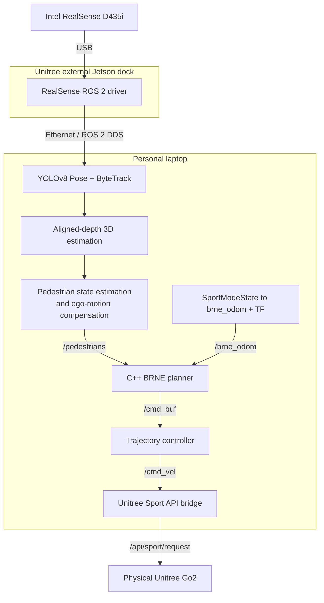

# BRNE Pedestrian-Aware Navigation on Unitree Go2

<p align="center">
  
  
  
  
</p>

**A physically validated RGB-D pedestrian-perception and BRNE navigation stack
for the Unitree Go2.** The robot accepts an RViz goal, tracks pedestrians with
YOLOv8 Pose and ByteTrack, estimates their state in a fixed planning frame, and
generates a socially aware avoidance trajectory with the C++ BRNE planner.

## Physical demonstration videos

The two views below are synchronized to the same part of the experiment. The
RViz screencast begins after its first 4 seconds, and the physical Go2 video
begins after its first 10 seconds. Both videos can be played directly from this
README.

### BRNE, perception, and RViz

https://github.com/user-attachments/assets/df9fe7b8-475d-4419-bbcb-1d927dce6f1f

### Physical Unitree Go2

https://github.com/user-attachments/assets/154ebcf8-e565-48ed-b779-6cbee4c4b4f1

## Overview

The RealSense D435i is connected to the robot's external Jetson dock. RGB,
aligned depth, and calibration data are transported over ROS 2 DDS through
Ethernet to a personal laptop. The laptop performs perception, pedestrian
state estimation, BRNE planning, visualization, control, and conversion to the
Unitree Sport API.

> This is research software for a physical quadruped. Testing must always be
> supervised by a safety operator with immediate emergency-stop access.

## Contents

- [Physical demonstration videos](#physical-demonstration-videos)
- [System architecture](#system-architecture)
- [Main project features](#main-project-features)
- [Tested configuration](#tested-configuration)
- [Build on the laptop](#build-on-the-laptop)
- [Network preparation](#network-preparation)
- [Run the tested physical system](#run-the-tested-physical-system)
- [Starting and stopping a trial](#starting-and-stopping-a-trial)
- [Important topics and frames](#important-topics-and-frames)
- [Stationary-pedestrian compensation](#stationary-pedestrian-compensation)
- [Repository structure](#repository-structure)

## System architecture

The deployed system uses two computers:

1. **Unitree external Jetson dock**
   - connected directly to the Intel RealSense D435i;
   - launches the RealSense ROS 2 driver;
   - publishes RGB, aligned depth, and camera information.
2. **Personal laptop**
   - connected to the robot/Jetson through Ethernet;
   - runs YOLOv8 Pose, ByteTrack, 3D pedestrian estimation, BRNE, RViz, the
     trajectory controller, and the Unitree Sport API bridge.

Both computers must use compatible ROS 2/DDS settings and discover each
other's topics over Ethernet.



## Main project features

- RGB-D pedestrian detection using YOLOv8 Pose and the RealSense D435i;
- persistent pedestrian IDs using ByteTrack;
- robust 3D pedestrian positions from aligned depth;
- timestamp-aware transformation from `camera_link` to `brne_odom`;
- compensation for robot translation and yaw rotation;
- Kalman-filtered pedestrian position and velocity;
- stationary-person deadband to suppress false motion estimates;
- C++ BRNE trajectory sampling and pedestrian avoidance;
- RViz goal selection and visualization of robot and pedestrian samples;
- Unitree Go2 Sport API command bridge with command timeout, tilt checks,
  velocity limits, explicit disarming, and optional arming on a new goal.

## Tested configuration

| Component | Validated setting |
|---|---|
| Robot | Unitree Go2 |
| RGB-D camera | Intel RealSense D435i |
| Camera computer | Unitree external Jetson dock |
| Planning computer | Personal laptop, YOLO inference on CPU |
| Host OS and ROS | Ubuntu with ROS 2 Jazzy |
| Middleware | Cyclone DDS |
| Camera streams | RGB + aligned depth, `640x480 @ 30 Hz` |
| Detector | `yolov8n-pose.pt` |
| Tracker | ByteTrack |
| Planner | C++ BRNE |
| Planning frame | `brne_odom` |
| Goal input | RViz 3D Goal Pose |
| Tested bridge limits | `0.90 m/s` linear, `0.90 rad/s` angular |

### Camera mounting calibration

The validated D435i transform relative to `base_link` is:

| Parameter | Value |
|---|---:|
| Forward translation (`x`) | `0.34 m` |
| Lateral translation (`y`) | `0.00 m` |
| Vertical translation (`z`) | `0.08 m` |
| Upward pitch | `30 degrees` |

These values are exposed as launch arguments. Remeasure them whenever the
camera mount changes; an incorrect extrinsic transform directly corrupts the
estimated pedestrian position and velocity.

## Software requirements

- Ubuntu with ROS 2 Jazzy;
- `realsense2_camera` on the external Jetson dock;
- `unitree_go` and `unitree_api` messages on the laptop;
- Cyclone DDS (`rmw_cyclonedds_cpp`);
- Python dependencies required by `yolo_ros`, including Ultralytics;
- Armadillo and OpenMP for BRNE.

The Unitree ROS 2 message workspace is external to this repository and must be
built and sourced before this workspace.

## Build on the laptop

Clone the workspace and build only the packages used by the D435i deployment:

```bash
git clone \
  https://github.com/AUB-RoboticsTeam/brne-go2-pedestrian-navigation.git \
  /home/user/pedestrian

source /opt/ros/jazzy/setup.bash
source /home/user/go2/install/setup.bash

cd /home/user/pedestrian

rosdep install --from-paths src --ignore-src -r -y \
  --skip-keys "zed_interfaces zed_components"

colcon build --symlink-install --packages-select \
  yolo_msgs yolo_ros yolo_bringup \
  crowd_nav_interfaces brnelib crowd_nav pedestrian_tracker

source install/setup.bash
export RMW_IMPLEMENTATION=rmw_cyclonedds_cpp
```

The imported upstream `pedestrian_tracking` package targets a ZED camera and
is not used by this RealSense deployment. Replace `/home/user/go2` and
`/home/user/pedestrian` if your workspaces use different locations.

## Network preparation

Before launching, verify that the Jetson and laptop:

- are connected through Ethernet and can ping each other;
- use the same `ROS_DOMAIN_ID`;
- use compatible DDS middleware and network-interface configuration;
- have synchronized clocks when possible;
- do not have a ROS daemon left running with different middleware settings.

At minimum, use the following environment on the laptop and the corresponding
ROS 2 environment on the Jetson:

```bash
source /opt/ros/jazzy/setup.bash
export RMW_IMPLEMENTATION=rmw_cyclonedds_cpp
```

## Run the tested physical system

Launch in this order:

1. RealSense driver on the external Jetson dock;
2. YOLOv8 Pose, ByteTrack, and 3D detection on the laptop;
3. pedestrian state estimation, BRNE, RViz, controller, and bridge on the
   laptop;
4. verify perception and TF before sending an RViz goal.

### 1. External Jetson dock: launch the D435i

Run on the robot's external Jetson dock:

```bash
source /opt/ros/jazzy/setup.bash
export RMW_IMPLEMENTATION=rmw_cyclonedds_cpp

ros2 launch realsense2_camera rs_launch.py \
  enable_depth:=true \
  enable_color:=true \
  enable_sync:=false \
  align_depth.enable:=true \
  depth_module.depth_profile:=640x480x30 \
  rgb_camera.color_profile:=640x480x30
```

Confirm on the laptop that these topics are visible before continuing:

```bash
ros2 topic hz /camera/camera/color/image_raw
ros2 topic hz /camera/camera/aligned_depth_to_color/image_raw
ros2 topic echo /camera/camera/aligned_depth_to_color/camera_info --once
```

### 2. Laptop: launch YOLOv8 Pose and ByteTrack

Open a new laptop terminal and source all workspaces:

```bash
source /opt/ros/jazzy/setup.bash
source /home/user/go2/install/setup.bash
source /home/user/pedestrian/install/setup.bash
export RMW_IMPLEMENTATION=rmw_cyclonedds_cpp

ros2 launch yolo_bringup yolov8.launch.py \
  device:=cpu \
  model:=yolov8n-pose.pt \
  threshold:=0.35 \
  iou:=0.60 \
  input_image_topic:=/camera/camera/color/image_raw \
  image_reliability:=2 \
  use_tracking:=True \
  use_3d:=True \
  use_debug:=True \
  input_depth_topic:=/camera/camera/aligned_depth_to_color/image_raw \
  input_depth_info_topic:=/camera/camera/aligned_depth_to_color/camera_info \
  depth_image_reliability:=2 \
  depth_info_reliability:=2 \
  target_frame:=camera_link \
  sync_slop:=0.08
```

### 3. Laptop: launch BRNE, RViz, controller, and Go2 bridge

Open another laptop terminal:

```bash
source /opt/ros/jazzy/setup.bash
source /home/user/go2/install/setup.bash
source /home/user/pedestrian/install/setup.bash
export RMW_IMPLEMENTATION=rmw_cyclonedds_cpp

ros2 launch pedestrian_tracker brne_yolo.launch.py \
  use_rviz:=true \
  start_controller:=true \
  start_unitree_bridge:=true \
  use_walls:=false \
  use_corridor_mask:=false \
  publish_robot_samples:=true \
  publish_pedestrian_samples:=true \
  unitree_max_linear_x:=0.90 \
  unitree_max_angular_z:=0.90 \
  use_sport_state_pose:=true \
  camera_x:=0.34 \
  camera_y:=0.0 \
  camera_z:=0.08 \
  camera_upward_pitch_deg:=30.0 \
  z_smoothing:=0.0 \
  heading_gain:=1.0 \
  unitree_auto_arm_on_goal:=true
```

The `0.90 m/s` and `0.90 rad/s` bridge limits reproduce the completed test
configuration. For the first run in a new environment, use substantially lower
limits and increase them only after validating TF, perception, stopping, and
command direction.

## Starting and stopping a trial

### Pre-motion verification

Keep the bridge disarmed and confirm that the required live data is available:

```bash
ros2 topic hz /lf/sportmodestate
ros2 topic hz /brne_odom
ros2 topic hz /yolo/detections_3d
ros2 topic hz /pedestrians
ros2 run tf2_ros tf2_echo brne_odom camera_link
```

Also confirm in RViz that:

- the robot pose follows the physical Go2 without jumps;
- a stationary pedestrian remains stationary when the robot translates or
  rotates;
- the green pedestrian marker agrees with the RGB-D detection;
- BRNE robot and pedestrian samples appear in the `brne_odom` frame;
- no unrelated person is inside the active planning region.

### Trial procedure

1. Start with the robot stationary and the test area clear.
2. Verify `/lf/sportmodestate`, `/brne_odom`, `/yolo/detections_3d`, and
   `/pedestrians`.
3. Verify in RViz that the robot and pedestrian positions are stable.
4. Keep the wireless controller and emergency stop immediately accessible.
5. Place the pedestrian only after perception has been verified.
6. Send a **3D Goal Pose** from RViz.
7. With `unitree_auto_arm_on_goal:=true`, a valid new goal arms the bridge after
   its robot-state and tilt checks pass.

To disarm and stop the robot immediately:

```bash
ros2 service call /unitree_cmd_vel_bridge/enable std_srvs/srv/SetBool \
  "{data: false}"
```

To require manual arming for every trial, launch with:

```text
unitree_auto_arm_on_goal:=false
```

Then arm explicitly only after all checks pass:

```bash
ros2 service call /unitree_cmd_vel_bridge/enable std_srvs/srv/SetBool \
  "{data: true}"
```

### Minimum physical safety checklist

- use a flat indoor area with free passing space on both sides;
- assign a separate safety operator;
- keep the wireless controller and emergency stop accessible;
- begin with low command limits in every new environment;
- verify a stable pedestrian track before motion;
- stop immediately if the track disappears, changes ID repeatedly, or jumps;
- never place a person where the robot has no safe escape path.

## Important topics and frames

| Purpose | Topic or frame |
|---|---|
| RealSense RGB | `/camera/camera/color/image_raw` |
| RealSense aligned depth | `/camera/camera/aligned_depth_to_color/image_raw` |
| YOLO 3D detections | `/yolo/detections_3d` |
| Unitree robot state | `/lf/sportmodestate` |
| Planning odometry | `/brne_odom` |
| BRNE pedestrians | `/pedestrians` |
| RViz goal | `/goal_pose` |
| BRNE command buffer | `/cmd_buf` |
| Controller output | `/cmd_vel` |
| Unitree Sport request | `/api/sport/request` |
| Planning transform | `brne_odom -> base_link -> camera_link` |

## Stationary-pedestrian compensation

The 3D detection is transformed at its observation timestamp rather than at
the latest available robot pose. For short transform gaps, the implementation
advances both the base translation and camera orientation:

$$
\Delta\psi = \dot{\psi}\,\Delta t
$$

$$
\mathbf p_b(t+\Delta t)
=
\mathbf p_b(t)
+
\mathbf R_z(\psi)\,\mathbf v_b\,\Delta t
$$

$$
\mathbf r_c(t+\Delta t)
=
\mathbf R_z(\Delta\psi)\,\mathbf r_c(t),
\qquad
\mathbf q_c(t+\Delta t)
=
\mathbf q_z(\Delta\psi)\otimes\mathbf q_c(t)
$$

Rotating both the camera lever arm and its quaternion prevents an in-place Go2
turn from appearing as pedestrian translation. The fixed 30-degree camera
pitch is retained through quaternion composition.

## Repository structure

```text
src/
|-- brne_social_nav/     # C++ BRNE library, planner, messages, and controller
|-- pedestrian_tracker/  # RealSense-to-BRNE adapter and Unitree integration
`-- yolo_ros/            # YOLOv8, ByteTrack, and RGB-D 3D detection
tools/                   # Supporting visualization utilities
media/videos/            # Demonstration-video location
```

Generated `build`, `install`, and `log` directories, local virtual
environments, rosbag recordings, and physical-trial data are intentionally not
stored in Git.

## Upstream projects and licensing

This workspace contains modified copies of:

- [`brne_social_nav`](https://github.com/katie-hughes/brne_social_nav)
- [`yolo_ros`](https://github.com/mgonzs13/yolo_ros)

Original notices and component licenses remain in their respective source
directories. In particular, `yolo_ros` is distributed under GPL-3.0. Review
all component licenses before redistribution.

